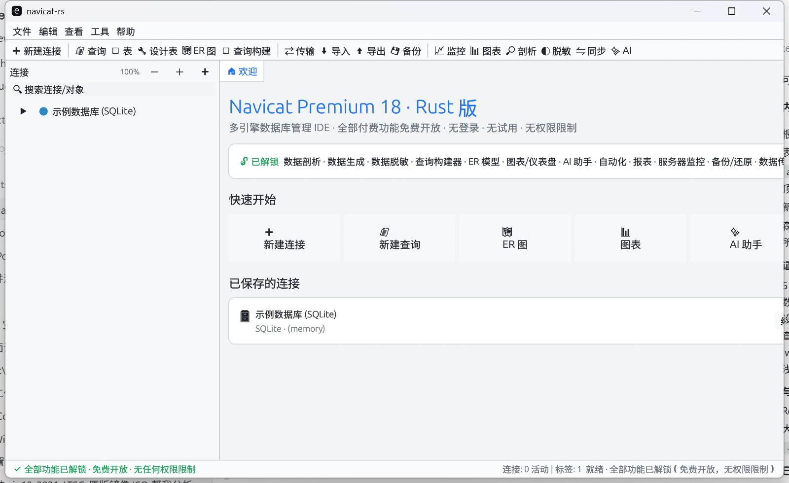

<p align="center">🌐 <b>Language</b>：<a href="README.md">简体中文</a> · <a href="README.en.md">English</a> · <a href="README.zh-TW.md">繁體中文</a> · <a href="README.ja.md">日本語</a> · <a href="README.ko.md">한국어</a> · <a href="README.ru.md">Русский</a> · <a href="README.es.md">Español</a> · <a href="README.fr.md">Français</a> · <a href="README.de.md">Deutsch</a> · <a href="README.pt-BR.md">Português</a></p>

# navicat-rs

> 📘 **[User Manual](docs/用户操作手册.en.md)** · [简体中文手册](docs/用户操作手册.md)

A **cross-platform single-file** database management desktop client built with **Rust + egui/eframe**, with UI and workflow inspired by Navicat Premium 18.
**All features are free and open; no login, no trial, no license/permission restrictions.**

<p>
  
  
  
  
  
  
</p>

> A **local-first** independent implementation with no cloud connection, no login, subscription, trial or telemetry. **All features are unconditionally available to everyone.**



---

## Why "unlimited"

Navicat's paid/login constraints are mainly **cloud / subscription** features (cloud sync, team collaboration, cloud automation, etc.). This tool implements only **cloud-independent local** database management, so it needs no account, no payment and has no quota. By design, login / subscription / license limits are removed; all local features are unconditionally available.

---

## Features

- **Tables**: paged browsing, filtering, inline editing, add/delete rows, sorting (click headers), export.
- **SQL query**: multi-statement execution, `Ctrl+Enter`, multi-grid results, timing / row count, Explain plan tree, SQL formatting, SQL outline / refactor hints, query history.
- **Design & modeling**: table designer (column edit → DDL), ER diagram, query builder, model designer (conceptual/logical/physical · reverse-engineer · compare · sync).
- **Data movement**: data transfer (column mapping + WHERE), data/structure sync, import wizard (CSV/JSON/SQL), export wizard (CSV/JSON/SQL/HTML), data pump.
- **Ops & extras**: backup/restore (incl. in-memory DB `VACUUM INTO`), server monitor, profiling, schema analysis, data generation, masking, charts, data dictionary, reports.
- **Objects & search**: object management (index/trigger/view), find-in-database (cross-table column search), object tree zoom and independent group collapse.
- **Other**: AI assistant, automation / scheduled tasks, code snippets, users & permissions (all open), settings (multi-theme / tree zoom / auto-commit / delete confirm).
- **Multi-theme**: light / dark / midnight / forest / sand / graphite; body and button text stay high-contrast and readable in every theme.

## GUI

- **Pure Rust + egui/eframe**: single-file exe, no WebView, double-click to run; embedded CJK fonts, no missing-glyph boxes.
- **Three-region layout**: menu bar / toolbar / tab bar / left connection & object tree / right feature pages / status bar.
- **Object tree**: connection → tables / views / backups / models / users; zoomable (`- 100% +`, `Ctrl+wheel`, settings slider), collapsible groups.
- **Multi-tab**: tables, queries, design, ER, builder and tool pages open in parallel tabs.
- **Multi-theme**: switch via `View → Theme` or `Settings → Theme`, choice persisted.

## Supported platforms

| Platform | Status | Notes |
|---|---|---|
| Windows x64 | ✅ built/verified | MSVC toolchain recommended; prebuilt exe in Releases |
| macOS (Intel / Apple Silicon) | ✅ CI build (universal) | Universal binary produced by `build.yml` |
| Linux (X11 / Wayland) | ✅ CI build | x64 archive produced by `build.yml` (needs system GUI deps) |

## Build

Requires Rust 1.75+ (stable recommended).

```bash
cargo build --release
```

### Windows (MSVC)

```powershell
# Requires Visual Studio Build Tools (C++ and Windows SDK)
cargo build --release
```

### macOS

```bash
xcode-select --install   # maybe needed first
cargo build --release
```

### Linux (Debian/Ubuntu)

```bash
sudo apt-get install -y build-essential pkg-config \
  libxkbcommon-dev libgtk-3-dev libgl1-mesa-dev \
  libx11-dev libxi-dev libxrandr-dev libxcursor-dev libxinerama-dev \
  libxcb-render0-dev libxcb-shape0-dev libxcb-xfixes0-dev
cargo build --release
```

## Prebuilt / cross-platform artifacts

- **Releases**: <https://github.com/shuying-code/navicat-rs/releases> (Windows x64 exe/zip, macOS universal tar.gz, Linux x64 tar.gz; built by `build.yml`).
- **CI matrix**: `.github/workflows/ci.yml` builds and runs `--selftest` on `ubuntu-latest / macos-latest / windows-latest`.
- **Container image (GHCR)**:

```bash
docker pull ghcr.io/shuying-code/navicat-rs:latest
docker run --rm ghcr.io/shuying-code/navicat-rs:latest --selftest
```

## Usage

```bash
navicat-rs              # launch the GUI
navicat-rs --selftest   # headless self-test (SQLite engine + key features, 22 checks)
```

On first launch it auto-creates a "Sample Database (SQLite)" (4 tables + 1 view + demo data). Double-click a table in the object tree to browse; the top toolbar opens query / table design / ER / query builder / transfer / import / export / backup / monitor / charts / profiling / AI and all other pages.

## Workspace (local config)

Config and state (connections, history, favorites, theme, settings) are stored in each platform's user config directory:

| Platform | Path |
|---|---|
| Windows | `%APPDATA%\navicat-rs\navicat-rs.json` |
| macOS | `~/Library/Application Support/navicat-rs/navicat-rs.json` |
| Linux | `$XDG_CONFIG_HOME/navicat-rs/navicat-rs.json` or `~/.config/navicat-rs/navicat-rs.json` |

## Verification

- `--selftest` covers engine and key features: **22 checks, all pass**.
- CI builds + self-test on three platforms (Windows / macOS / Ubuntu): **all success**.
- 6 themes screenshot-checked for readability of body / bold titles / headers / button text.

## Database backends

| Engine | Status |
|---|---|
| SQLite | **Fully real**: connection, query, CRUD, DDL, scripts, foreign keys, PRAGMA (`rusqlite` bundled, cross-platform) |
| PostgreSQL | **Real network protocol**: connection test + real queries (pure Rust `postgres` driver) |
| MySQL / MariaDB / Oracle / SQL Server / MongoDB / Redis / Snowflake / Dameng / ODBC | Connection config + offline demo schema (UI/workflow complete; driver layer abstracted, can be added per `src/realdb.rs`) |

## CLI arguments

| Argument | Description |
|---|---|
| (none) | Launch the GUI |
| `--selftest` | Headless self-test, prints `[PASS]/[FAIL]` and returns an exit code (0 = all pass) |

## Environment variables (optional)

| Variable | Description |
|---|---|
| `NAVICAT_RS_THEME` | Theme at startup: `light`/`dark`/`midnight`/`forest`/`sand`/`graphite` |
| `NAVICAT_RS_DEMO` | `1` opens sample queries and tables; `all` opens all feature pages (for screenshots/acceptance) |
| `NAVICAT_RS_TAB` | With demo, switch to the tab whose title contains this substring |

## FAQ

**Q: Do I need a Navicat account or license?** No. The app opens straight to the main UI; no login / activation / trial prompts.

**Q: Where is the data stored?** See "Workspace"; Windows `%APPDATA%\navicat-rs\navicat-rs.json`; the database itself is your connected SQLite file.

**Q: Why is the macOS binary built in CI?** This machine is Windows; the macOS universal binary is produced by GitHub Actions `macos-latest` (see `build.yml`).

**Q: Can a non-SQLite engine really connect?** SQLite is fully real and PostgreSQL uses the real network protocol; the others are connection config + offline demo DB, extendable per `src/realdb.rs`.

## Feedback (Issues)

Use GitHub Issues: <https://github.com/shuying-code/navicat-rs/issues/new/choose>. Please read the **[feedback guide](docs/FEEDBACK.md)** first. Maintainers usually triage issues once per week.

## License

[MIT](LICENSE)
