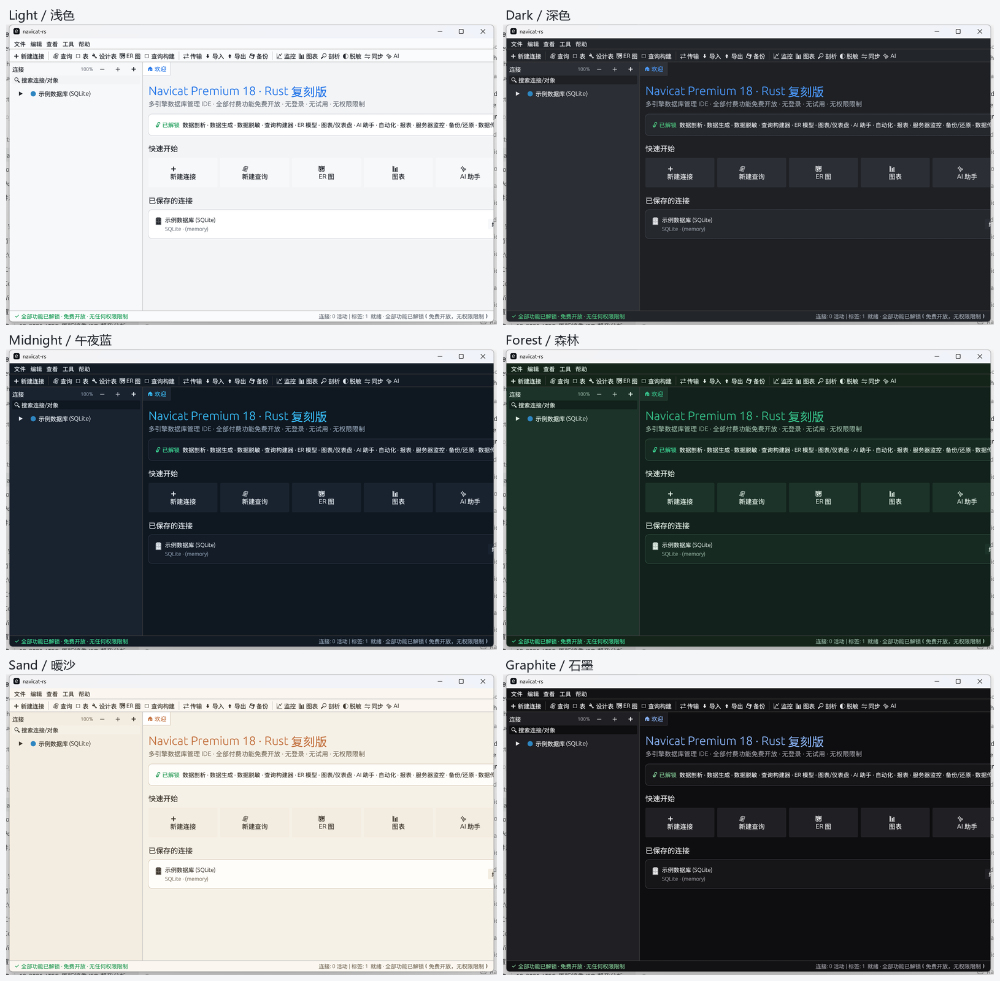

# navicat-rs

一个用 **Rust + egui/eframe** 编写的跨平台数据库管理桌面客户端，界面与工作流参考 Navicat Premium 18。
**所有功能全部免费开放，无登录、无试用、无授权/权限限制。**

[](https://github.com/zhouyulong123/navicat-rs/actions/workflows/ci.yml)
[](LICENSE)
[](#支持的平台)
[](https://www.rust-lang.org)


## 功能特性

- **数据表**：分页浏览、过滤、内联编辑、增删行、排序、导出。
- **SQL 查询**：多语句执行、`Ctrl+Enter`、结果多网格、耗时/行数、Explain 执行计划树、SQL 美化、SQL 大纲/重构建议、查询历史。
- **设计与建模**：表结构设计器、ER 图、查询构建器、模型设计器（概念/逻辑/物理 · 反向工程 · 对比 · 同步）。
- **数据搬运**：数据传输（列映射 + WHERE 过滤）、数据同步/结构同步、导入向导（CSV/JSON/SQL）、导出向导（CSV/JSON/SQL/HTML）、数据泵（整库/单表 SQL）。
- **运维与增强**：备份/还原（含内存库 `VACUUM INTO`）、服务器监控、数据剖析、模式分析、数据生成、数据脱敏、图表、数据字典、报表。
- **对象与查找**：索引/触发器/视图管理、跨表查询值搜索、对象树缩放与分组折叠。
- **其他**：AI 助手、自动化/计划任务、代码片段、用户与权限（全部开放）、设置（多主题、树缩放、自动提交、删除确认）。
- **多主题**：浅色 / 深色 / 午夜蓝 / 森林 / 暖沙 / 石墨，所有主题下正文与按钮文字均保持高对比可读。

## 主题



## 支持的平台

| 平台 | 状态 | 说明 |
|---|---|---|
| Windows x64 | ✅ 已构建验证 | 推荐使用 MSVC 工具链 |
| macOS (Intel / Apple Silicon) | ✅ 源码与 CI 支持 | 由 CI 在 `macos-latest` 构建 |
| Linux (X11 / Wayland) | ✅ 源码与 CI 支持 | 由 CI 在 `ubuntu-latest` 构建（需系统 GUI 依赖） |

程序基于 `eframe/egui`，在三大桌面平台上使用同一套源码；配置文件按平台写入各自的标准目录（见下文）。

## 快速开始

需要 Rust 1.75+（推荐 stable）。

```bash
# 构建（release）
cargo build --release

# 运行
cargo run --release            # 或直接运行 target/release/navicat-rs(.exe)

# 无头自检（引擎层 + 关键功能，22 项）
target/release/navicat-rs --selftest        # Windows: target\release\navicat-rs.exe --selftest
```

首次启动会自动创建一个“示例数据库 (SQLite)”（4 张表 + 1 个视图 + 演示数据）。左侧对象树双击表即可浏览；顶部工具条可打开查询 / 设计表 / ER 图 / 查询构建 / 传输 / 导入 / 导出 / 备份 / 监控 / 图表 / 剖析 / AI 等全部页面。

### 各平台构建

**Windows（MSVC）**

```powershell
# 需已安装 Visual Studio Build Tools（含 C++ 与 Windows SDK）
cargo build --release
```

**macOS**

```bash
xcode-select --install   # 首次可需安装命令行工具
cargo build --release
```

**Linux（Debian/Ubuntu）**

```bash
sudo apt-get install -y build-essential pkg-config \
  libxkbcommon-dev libgtk-3-dev libgl1-mesa-dev \
  libx11-dev libxi-dev libxrandr-dev libxcursor-dev libxinerama-dev \
  libxcb-render0-dev libxcb-shape0-dev libxcb-xfixes0-dev
cargo build --release
```

## 数据存储位置

配置与状态（连接、历史、收藏、主题、设置）保存在各平台的用户配置目录：

| 平台 | 路径 |
|---|---|
| Windows | `%APPDATA%\navicat-rs\navicat-rs.json` |
| macOS | `~/Library/Application Support/navicat-rs/navicat-rs.json` |
| Linux | `$XDG_CONFIG_HOME/navicat-rs/navicat-rs.json` 或 `~/.config/navicat-rs/navicat-rs.json` |

## 数据库后端

| 引擎 | 状态 |
|---|---|
| SQLite | **完全真实**：连接、查询、CRUD、DDL、脚本、外键、PRAGMA（`rusqlite` bundled，跨平台） |
| PostgreSQL | **真实网络协议**：连接测试 + 真实查询（纯 Rust `postgres` 驱动） |
| MySQL / MariaDB / Oracle / SQL Server / MongoDB / Redis / Snowflake / 达梦 / ODBC | 连接配置 + 离线演示 schema（界面/工作流完整；驱动层已抽象，可按 `src/realdb.rs` 模式逐个接入） |

## 项目结构

```
src/
  main.rs      程序入口、窗口配置、--selftest 自检
  app.rs       应用状态、标签页路由、动作处理
  model.rs     数据模型（连接 / 列 / 对象）
  store.rs     跨平台配置持久化（JSON）
  db.rs        SQLite 引擎（查询 / CRUD / DDL / 备份 / 数据泵）
  realdb.rs    PostgreSQL 真实网络协议驱动
  theme.rs     多主题配色与样式
  ui/          各功能页面（table / query / designer / er / qb / tools / tree）
assets/        内嵌中文字体与截图
docs/          设计、功能矩阵与验收文档
```

## 文档

| 文件 | 内容 |
|---|---|
| `docs/01_逆向分析总报告.md` | 安装包解包、技术栈与特性清单 |
| `docs/02_功能矩阵与业务逻辑.md` | 能力域 → 实现状态的完整矩阵 |
| `docs/03_收费与权限去除说明.md` | 全部功能开放的实现与代码级核验 |
| `docs/04_Rust复刻架构与映射.md` | 工程结构与模块映射 |
| `docs/05_验收报告.md` | 构建 / 自检 / 截图 / 覆盖度验收 |
| `docs/06_十次迭代记录.md` | 迭代过程与关键修复 |
| `docs/07_功能覆盖与差距清单.md` | 覆盖度核对与后续项 |

## 说明

- 本项目为独立的界面与工作流实现，不包含、不调用任何第三方商业软件的二进制或许可证。
- “全部功能免费开放”指本工程自身不设任何授权或权限限制。
- SQLite 为完全真实的本地后端；PostgreSQL 已接入真实网络协议；其余引擎当前为连接配置 + 离线演示数据，可按 `src/realdb.rs` 扩展。

## 许可证

[MIT](LICENSE)
